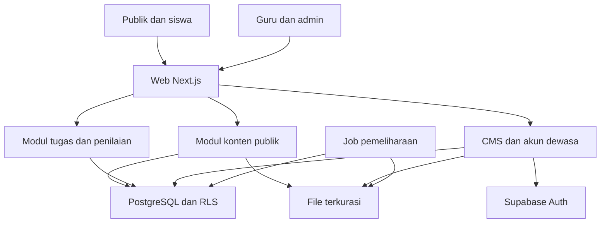
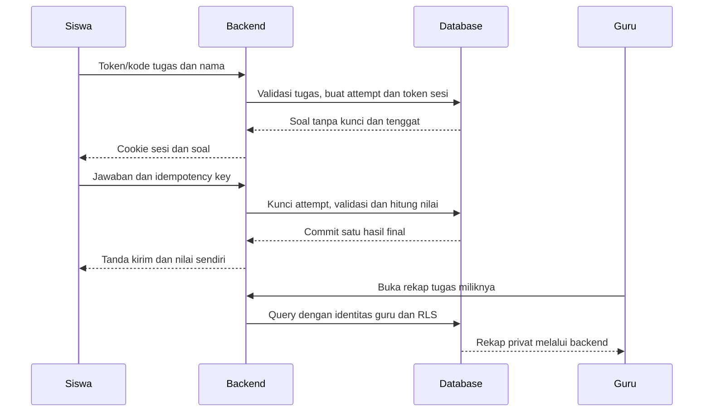

# Arsitektur Sistem dan Rekomendasi Tech Stack

## 1. Rekomendasi utama

Gunakan **modular monolith**: satu aplikasi Next.js dengan modul konten, pembelajaran, penilaian, akun dan administrasi yang dipisahkan di tingkat kode. Database, autentikasi dan penyimpanan file menggunakan Supabase terkelola. Ini merupakan rekomendasi berdasarkan kebutuhan proyek kecil–menengah, bukan keharusan dari proposal.

Konten publik memakai rendering server/prerender dan cache. Dashboard dan aktivitas kuis memakai backend dinamis. Semua operasi bisnis melalui backend aplikasi pada origin yang sama; siswa tidak memperoleh akses langsung ke tabel nilai atau kunci jawaban.

## 2. Stack yang dipilih

| Lapisan | Rekomendasi | Alasan/ketentuan |
| --- | --- | --- |
| Bahasa | TypeScript mode strict | Kontrak data front-end/back-end konsisten |
| Web | Next.js App Router + React | Halaman ensiklopedia dapat diindeks dan aplikasi guru/admin tetap satu proyek |
| Tampilan | Tailwind CSS; komponen aksesibel yang dipilih setelah desain | Tidak menetapkan tema atau visual final |
| Form dan validasi | React Hook Form + Zod | Validasi ulang wajib di server; klien untuk kenyamanan |
| Backend | Next.js Route Handlers, REST `/api/v1` | Menyederhanakan deploy, auth, kuis dan CMS |
| Database | PostgreSQL terkelola Supabase | Relasi kelas–tugas–percobaan, transaksi, constraint dan RLS |
| Auth dewasa | Supabase Auth, email/kata sandi dan verifikasi email | Akun hanya guru/admin; undangan admin; MFA admin |
| Auth siswa | Token sesi opaque buatan backend | Tanpa akun termasuk tanpa akun anonymous Supabase |
| Akses data | Supabase client server untuk pengguna dewasa; SQL migrations dan database function | Gunakan generated database types; tidak menambah ORM kedua pada MVP |
| CMS | Modul admin khusus | Mendukung validasi konten, privasi situs dan bank soal sesuai kebutuhan |
| Editor | Rich text terstruktur dengan allowlist, misalnya Tiptap | Simpan JSON terstruktur; jangan mengizinkan HTML/script bebas; pustaka dievaluasi saat implementasi |
| File | Supabase Storage, bucket privat dan turunan publik tersanitasi | Pisahkan master, unggahan karantina dan hasil publikasi |
| PDF | PDF.js yang dihosting sendiri; fallback unduh | Reader terintegrasi, bukan ketergantungan viewer eksternal |
| Peta | Leaflet stabil + penyedia tile berlisensi | Menampilkan wilayah umum; library dan layanan tile adalah hal berbeda |
| QR | Library QR lokal | Membuat QR link tugas tanpa mengirim data ke generator pihak ketiga |
| Pencarian | PostgreSQL full-text `simple`, normalisasi dan trigram bila tersedia | Cukup untuk katalog awal; tidak memerlukan Elasticsearch |
| Pengujian | Vitest, Playwright dan uji SQL/RLS | Fokus aturan penilaian, alur siswa/guru dan isolasi akses |
| Observabilitas | Log terstruktur tersanitasi, uptime monitor, error tracker dengan scrub PII | Tidak mengirim nama, jawaban, token atau body request ke tracker |
| Background job | Cron terautentikasi + tabel pekerjaan/outbox | Retensi, ekspor dan notifikasi dewasa; tidak perlu Kafka |
| Hosting web utama | Vercel Pro atau hosting Node terkelola setara | Evaluasi region, biaya, ketentuan penggunaan dan proteksi akses |

Versi framework, Node LTS, PostgreSQL dan pustaka harus dipilih dari rilis stabil yang masih didukung pada saat implementasi; dikunci dalam lockfile dan diuji di staging. Dokumen tidak membekukan nomor versi yang belum diuji. Jangan memilih beta hanya karena lebih baru.

## 3. Perbandingan opsi

| Opsi | Kelebihan | Beban/risiko | Kesesuaian |
| --- | --- | --- | --- |
| Next.js + Supabase terkelola | Satu bahasa, transaksi SQL, auth/storage siap, operasional relatif ringan | Langganan, RLS harus benar, ketergantungan layanan | Pilihan utama jika tim belum mempunyai preferensi teknis |
| Laravel + Filament + PostgreSQL + object storage | CMS cepat dikembangkan, cocok tim PHP | Setup auth, backup, queue dan server tetap perlu diurus | Alternatif kuat jika pengembang/pengelola berpengalaman PHP |
| WordPress + plugin kuis | Publikasi artikel cepat | Tugas tanpa akun, isolasi nilai, revisi dan privasi mungkin perlu plugin khusus; konflik pembaruan | Tidak dipilih sebagai dasar alur penilaian khusus ini |
| Next.js + PostgreSQL di VPS | Infrastruktur dapat dikendalikan dan batas biaya lebih langsung | Pengelola menanggung patch OS, database, auth dan restore | Jika ada administrator teknis yang ditugaskan |
| Firebase | Auth dan layanan terkelola terintegrasi | Model dokumen menambah kerja untuk relasi/revisi/laporan SQL | Tidak dipilih untuk kebutuhan relasional ini |

## 4. Diagram komponen

Diagram menyederhanakan jalur untuk keterbacaan. Browser mengakses media publik yang telah disetujui; file privat melalui URL bertanda tangan. Browser dewasa tidak menjadi sumber otorisasi. Tile peta dimuat terpisah hanya pada halaman peta; siswa tidak mengirim nama/nilai ke penyedia tile.

## 5. Batas kepercayaan dan akses database

1. **Browser publik:** tidak dipercaya untuk nama, waktu, nilai, kelas atau hak akses. Hanya input pengguna dan token opaque yang diterima.
2. **Backend publik:** membaca proyeksi konten terbitan dengan role berhak minimum. Output API dibentuk eksplisit agar kunci/revisi privat tidak bocor.
3. **Backend guru/admin:** memverifikasi sesi melalui penyedia auth. Query normal menggunakan token pengguna dan RLS; role aplikasi berasal dari tabel yang hanya dapat diubah proses admin berwenang. Jangan memakai metadata profil yang dapat diedit pengguna untuk menentukan peran.
4. **Backend kuis tamu:** karena tidak ada identitas Auth siswa, gunakan role database khusus `guest_api` melalui koneksi server ber-TLS/pooler. Role ini hanya mendapat EXECUTE pada fungsi tugas/kuis yang diizinkan, tanpa hak SELECT/INSERT langsung ke tabel. Fungsi memeriksa token, tugas, tenggat, revisi dan state secara internal.
5. **Fungsi berhak istimewa:** gunakan owner non-login berhak minimum, `SECURITY DEFINER` hanya bila diperlukan, `search_path` tetap/kosong, nama tabel fully-qualified, revoke EXECUTE default dari PUBLIC/anon/authenticated. Migration mendefinisikan grant secara eksplisit. Kredensial guest_api hanya di server.
6. **Admin Auth dan pemeliharaan:** secret/service-role provider hanya pada modul server terpisah untuk undangan, bootstrap dan job yang benar-benar membutuhkan. Secret dapat melewati RLS; tidak dipakai sebagai client umum untuk dashboard. Jangan memasukkannya ke bundel publik atau variabel `NEXT_PUBLIC_*`.

Role `guest_api`, pooler dan fungsi perlu proof-of-concept awal. Jika provider membatasi role/koneksi, gunakan fungsi server berprivilege yang sempit dengan kredensial server terpisah dan pemeriksaan ekuivalen; perubahan tersebut harus dicatat dalam ADR serta diuji, bukan membuka akses tabel `anon` sebagai jalan pintas.

## 6. Siklus pengerjaan dan transaksi

Penerimaan nilai tidak bergantung email atau realtime service. Guru memperoleh pembaruan via polling sekitar 15 detik ketika tab aktif. Setelah sukses submit, nilai sudah ada di database meskipun dashboard guru sedang tertutup.

## 7. Publikasi dan media

CMS menyimpan revisi draf terpisah dari revisi terbit. Publikasi mengalihkan pointer revisi secara atomik setelah kelengkapan validasi terpenuhi, lalu menghapus cache publik terkait. Draf/revisi lama tidak tersedia melalui API publik. QR konten menggunakan slug/ID publik stabil, sehingga pembaruan revisi tidak memutus materi cetak.

Unggahan masuk karantina privat → cek jenis/ukuran dan scan → hapus EXIF/metadata sensitif → buat turunan web → periksa kredit, caption, hak akses dan konten → tautkan ke revisi → publikasi. File sumber tidak otomatis menjadi publik. Media/dokumen yang sudah telanjur publik dapat tersimpan di pihak lain; karena itu pemeriksaan dilakukan sebelum penerbitan.

Video direkomendasikan berupa MP4 terkompresi yang dikelola pengelola dan diunggah melalui jalur storage, bukan body request backend. Gunakan poster, `preload=none`, caption dan transkrip. HLS/CDN video khusus ditambahkan jika pengukuran bandwidth membenarkannya. Embed YouTube tidak menjadi default untuk audiens anak karena kontrol data dan konten pihak ketiga perlu dinilai.

## 8. Integrasi API eksternal

| Integrasi | Wajib? | Aturan |
| --- | --- | --- |
| Supabase Auth | Ya untuk guru/admin | Email terverifikasi, pemulihan, MFA admin, callback allowlist |
| PostgreSQL dan Storage | Ya pada stack utama | Credential server terpisah, RLS/grant, signed upload terbatas |
| Tile peta | Untuk peta interaktif | Penyedia dengan lisensi/quota jelas; atribusi; fallback daftar wilayah |
| Email transaksional | Ya untuk undangan/reset akun dewasa | SMTP provider yang dinilai; tanpa nama/nilai siswa pada isi email |
| Error tracker | Opsional | PII scrub, sampling dan batas retensi |
| AI/OpenAI API | Tidak | Tidak dibutuhkan untuk ensiklopedia terkurasi dan penilaian pilihan ganda |
| Google Maps, WhatsApp, payment | Tidak | Tidak menambah biaya/data keluar yang tidak diperlukan |

## 9. Cache, SEO dan jaringan

Hanya konten terbitan dapat masuk shared cache, sitemap dan metadata SEO. Task join, API sesi, dashboard, ekspor, auth callback dan hasil memakai `Cache-Control: private, no-store`; `noindex` sebagai tambahan, bukan kontrol akses. Service worker tidak diperlukan pada MVP. Jika PWA ditambahkan, larang caching rute dan respons sensitif.

Token link tidak diteruskan ke analytics atau referer pihak ketiga. Halaman join memakai `Referrer-Policy: no-referrer` dan tanpa embed luar. Halaman peta publik dapat memakai kebijakan referer berbeda yang sesuai penyedia; tidak membawa informasi tugas. Parser URL dan allowlist mencegah SSRF dari impor konten/media.

## 10. Struktur kode yang diusulkan

| Direktori | Tanggung jawab |
| --- | --- |
| `src/app/(public)` | Beranda, konten, media, ruang guru publik |
| `src/app/(learning)` | Masuk tugas, pengerjaan dan hasil sendiri |
| `src/app/guru` | Dashboard, kelas, tugas dan rekap |
| `src/app/admin` | CMS, validasi, bank soal, akun dan operasi |
| `src/app/api/v1` | Kontrak HTTP dan pemetaan error |
| `src/modules/content` | Publikasi, revisi dan pencarian |
| `src/modules/learning` | Tugas, sesi, jawaban dan penilaian |
| `src/modules/identity` | Sesi dewasa, role dan otorisasi |
| `src/lib/server` | Client DB/Auth, secret, storage, audit; ditandai server-only |
| `supabase/migrations` | DDL, fungsi, grants, RLS dan seed nonproduksi |
| `tests` | Uji unit, kontrak, integrasi, E2E dan akses |
| `docs/adr` | Rekam keputusan yang berubah saat implementasi |

## 11. Keputusan arsitektur

ADR-01 satu aplikasi modular; ADR-02 PostgreSQL relasional; ADR-03 siswa guest session tanpa akun; ADR-04 nilai dan kunci di server; ADR-05 revisi konten/kuis immutable setelah disetujui; ADR-06 tidak menyimpan koordinat tepat; ADR-07 materi guru terbuka, nilai privat; ADR-08 produksi terkelola sebagai rekomendasi awal. Pemecahan microservices, realtime penuh, Redis dan pencarian eksternal ditunda sampai ada kebutuhan terukur.
