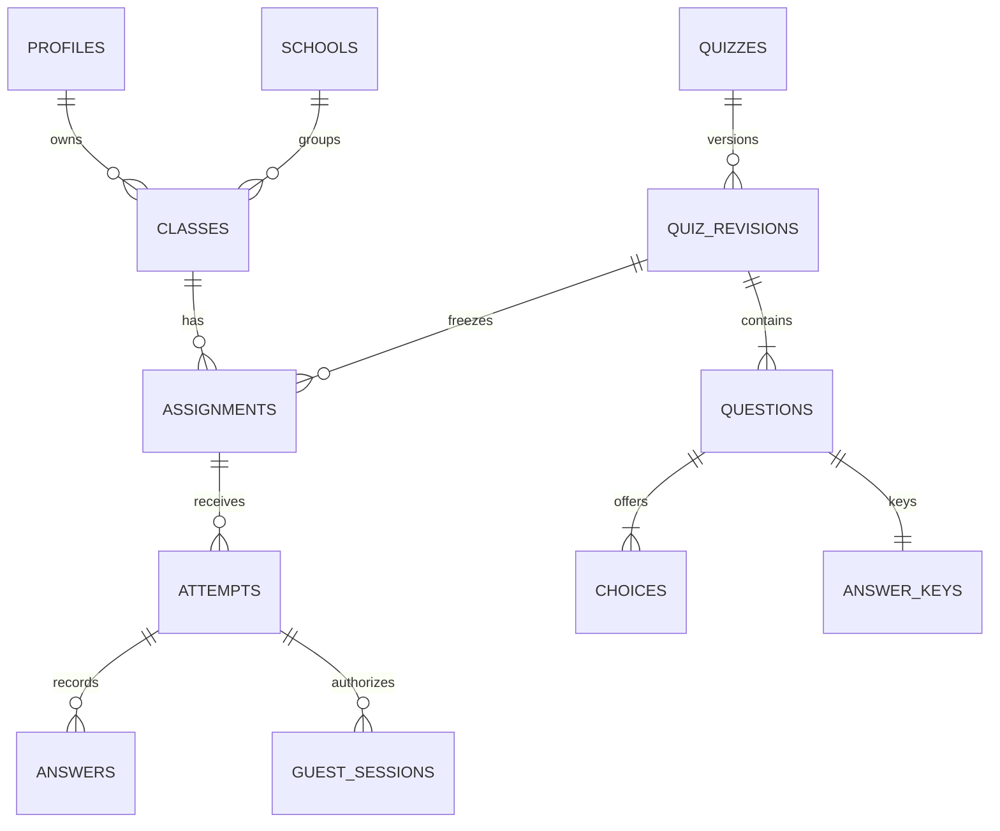
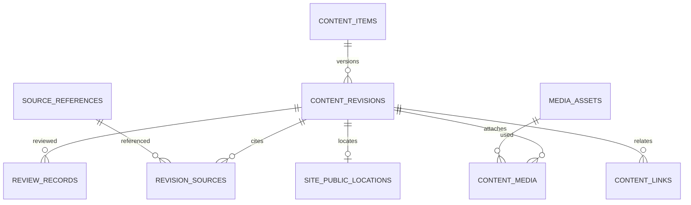

# Rancangan Database

Status: model logis dan spesifikasi integritas; belum merupakan migration SQL siap dijalankan. Seluruh waktu `timestamptz` disimpan UTC. ID menggunakan UUID acak; UUID bukan bukti hak akses.

## 1. Prinsip

PostgreSQL menjadi sumber kebenaran untuk konten, tugas dan nilai. File biner disimpan di object storage, hanya metadata/path yang ada di database. Tidak ada tabel akun siswa. Nama melekat pada percobaan kuis, bukan pada identitas global anak. Relasi, constraint, transaksi dan RLS wajib diterapkan melalui migration yang dapat ditinjau.

Gunakan schema `app` untuk data bisnis yang diperlukan client server beridentitas, `private` untuk kunci, sesi dan operasi sensitif, serta `api` untuk fungsi/proyeksi yang sengaja diekspos. Nama schema dapat disesuaikan batas provider, tetapi tidak boleh mengubah hak akses. `private` tidak masuk exposed Data API.

## 2. Relasi inti

## 3. Identitas dan institusi

| Tabel | Kolom inti | Constraint dan akses |
| --- | --- | --- |
| `app.profiles` | `user_id` FK Auth, `role` teacher/admin, `display_name`, `status` invited/active/suspended, timestamps | PK user_id; pengguna tidak dapat mengubah role/status sendiri; akun aktif diperiksa API dan RLS |
| `app.schools` | `id`, `name`, `district_label`, `status` | Nama sekolah bukan direktori siswa; admin kelola |
| `app.teacher_schools` | `teacher_id`, `school_id`, `status` | Unique pasangan; admin menetapkan hubungan; guru tidak dapat bergabung sekolah lewat perubahan profil |
| `app.classes` | `id`, `teacher_id`, `school_id`, `label`, `grade`, `academic_year`, `archived_at` | CHECK grade IN (3,4); FK guru aktif; kelas hanya untuk school membership yang sah; owner immutable |

Kelas tidak menyimpan roster siswa pada MVP. Label seperti `III A` dan tahun ajaran tidak berisi data pribadi anak. Dua guru dalam sekolah yang sama tetap tidak saling melihat kelas/nilai.

## 4. Konten dan validasi

| Tabel | Kolom inti | Aturan |
| --- | --- | --- |
| `app.content_items` | `id`, `kind`, `slug`, `published_revision_id`, `archived_at`, `created_by` | kind: book/chapter/site/glossary/video/guide/worksheet/page/news; slug unique; published pointer harus menuju revisi item sendiri |
| `app.content_revisions` | `id`, `content_id`, `version_no`, `title`, `summary`, `body_json`, `target_grades`, `metadata_json`, `status`, `created_by`, timestamps | Unique content_id/version_no; JSON divalidasi per kind; isi revisi yang disetujui/terbit immutable |
| `app.review_records` | `id`, `revision_id`, `review_type`, `reviewer_label`, `decision`, `notes`, `evidence_asset_id`, `recorded_by`, `reviewed_at` | review_type language/material/media/location; evidence privat; keputusan terikat revisi |
| `app.source_references` | `id`, `citation_text`, `url`, `doi`, `accessed_at`, `source_type` | Tidak mengklaim DOI terverifikasi tanpa pemeriksaan editorial |
| `app.revision_sources` | `revision_id`, `source_id`, `locator`, `note` | PK pasangan + locator bila perlu; mendukung kutipan halaman |
| `app.content_links` | `id`, `revision_id`, `target_content_id`, `relation_type`, `sort_order` | Relasi book→chapter, materi→glosarium, materi→LKPD; cek siklus bab dan tipe relasi |
| `app.site_public_locations` | `revision_id`, `area_label`, `display_lat`, `display_lon`, `precision_label`, `display_zoom_max`, `clearance_review_id` | Hanya titik representatif wilayah umum; lat/lon rentang sah; pasangan wajib bersama; clearance untuk revisi sama |
| `app.media_assets` | `id`, `kind`, `storage_bucket`, `storage_path`, `visibility`, `scan_status`, `checksum_sha256`, `mime`, `bytes`, `credit`, `license`, `metadata_scrubbed_at` | Status quarantine/cleared/rejected; path unik; master dan turunan adalah baris terpisah |
| `app.content_media` | `revision_id`, `asset_id`, `role`, `alt_text`, `caption`, `sort_order` | Hanya aset cleared yang boleh dipublikasikan; caption/alt terkait konteks pemakaian |
| `app.site_settings` | `key`, `value_json`, `updated_by`, `updated_at` | Allowlist key dan schema; tidak menyimpan secret atau HTML bebas |

`metadata_json` menampung field sesuai jenis, misalnya tujuan/durasi panduan atau durasi/transkrip video; bukan tempat menyembunyikan akses/kunci. Bab buku disimpan sebagai item konten, urutan bab di `content_links`. Kuota, ukuran dan validasi JSON dibatasi.

Publik membaca proyeksi kolom terpilih dari pointer terbit saja. Jangan mengandalkan filter status dari browser. View menggunakan semantics `security_invoker` jika digunakan untuk data ber-RLS; evaluasi grant dan kolom yang terekspos. Koordinat tepat dan arsip lapangan tidak disimpan pada sistem MVP ini.

## 5. Kuis dan tugas

| Tabel | Kolom inti | Aturan |
| --- | --- | --- |
| `app.quizzes` | `id`, `slug`, `published_revision_id`, `archived_at` | Identitas kuis stabil; pointer hanya revisi sendiri |
| `app.quiz_revisions` | `id`, `quiz_id`, `version_no`, `title`, `grade`, `usage_mode`, `instructions`, `status`, `validated_by`, timestamps | grade 3/4; usage_mode practice/assignment; terbit immutable; rekam bukti validasi dalam tabel berikut |
| `app.quiz_review_records` | `id`, `quiz_revision_id`, `review_type`, `decision`, `reviewer_label`, `evidence_asset_id`, timestamps | Validasi bahasa/materi/media bila relevan; sumber pertanyaan ditautkan melalui question_sources |
| `app.quiz_questions` | `id`, `quiz_revision_id`, `position`, `prompt_json`, `media_asset_id` | Unique revisi/position; satu jawaban benar; minimum satu soal sebelum publish |
| `app.quiz_choices` | `id`, `question_id`, `position`, `label_json` | Unique question/position; 2–4 pilihan; tidak mempunyai kolom is_correct pada proyeksi publik |
| `private.quiz_answer_keys` | `question_id`, `correct_choice_id`, `explanation_json` | PK question; composite FK memastikan choice milik question; tidak dapat dibaca role publik/guru |
| `app.question_sources` | `question_id`, `source_id`, `locator` | Rujukan substansi soal |
| `app.assignments` | `id`, `class_id`, `quiz_revision_id`, `title`, `state`, `opens_at`, `closes_at`, `session_minutes`, `consent_policy_version`, `consent_readiness_at`, `created_by` | state draft/open/closed/revoked/archived; closes>opens; session_minutes default 120; grade sama dengan kelas; kuis terbit mode assignment |
| `private.assignment_access` | `assignment_id`, `join_token_hash`, `join_code_digest`, `generation`, `rotated_at` | Token hash SHA-256 untuk random128+bit; kode HMAC dengan secret pepper server; unique digest untuk kode aktif |
| `private.consent_evidence_refs` | `id`, `class_id`, `attempt_id` nullable, `external_reference`, `policy_version`, `recorded_by`, `recorded_at`, `withdrawn_at` | Referensi bukti persetujuan yang dikelola sekolah; tidak menyimpan dokumen identitas orang tua |

`consent_readiness_at` hanya menyatakan kesiapan administrasi kelas; bukan pengganti persetujuan setiap anak. Sekolah harus mempunyai cara memastikan peserta yang mengisi nama termasuk yang mempunyai persetujuan yang sah. Keterbatasan identitas tanpa akun dicatat; verifikasi dilakukan dalam pendampingan guru.

## 6. Percobaan, jawaban dan hasil

| Tabel | Kolom inti | Aturan |
| --- | --- | --- |
| `app.attempts` | `id`, `assignment_id`, `quiz_revision_id`, `student_name`, `corrected_name` nullable, `state`, `answer_revision`, `started_at`, `expires_at`, `submitted_at`, `correct_count`, `question_count`, `score`, `receipt_code`, `purge_at` | State in_progress/submitted/expired/cancelled; revision nonnegatif; nama 1–80 karakter setelah trim; kuis sama dengan assignment; score numeric(5,2) 0–100; tidak unique berdasarkan nama |
| `app.attempt_questions` | `attempt_id`, `question_id`, `position`, `choice_order_json` | PK attempt/question; membekukan urutan yang ditampilkan dan anggota revisi yang sah |
| `app.attempt_answers` | `attempt_id`, `question_id`, `selected_choice_id` nullable, `updated_at`, `is_correct` nullable | PK attempt/question; composite FK memastikan question milik attempt dan choice milik question; is_correct hanya ditulis penilaian server |
| `private.guest_sessions` | `id`, `attempt_id`, `token_hash`, `issued_at`, `expires_at`, `revoked_at` | Hash token random minimal 256 bit; token mentah hanya pada cookie browser; tidak di log |
| `private.idempotency_records` | `scope`, `key_digest`, `request_hash`, `attempt_id`, `response_json`, `created_at`, `expires_at` | Unique scope/key_digest; response minimal tanpa nama; purge 24 jam; response replay tetap memeriksa sesi dan expiry |
| `app.attempt_annotations` | `id`, `attempt_id`, `actor_id`, `kind`, `reason`, `created_at` | Status verifikasi, hasil tidak sah atau koreksi; bukan update kunci/skor |
| `app.result_selections` | `assignment_id`, `normalized_name_digest`, `selected_attempt_id`, `selected_by`, `reason` | Pilihan guru opsional; hanya alat bantu grouping nama, bukan identitas siswa unik; selected attempt harus dalam tugas sama |

Rumus hasil memakai total soal revisi yang dibekukan, bukan jumlah soal yang dijawab. Jawaban kosong bernilai nol. Nilai historis tetap sesuai kunci revisi yang digunakan; koreksi resmi membutuhkan ledger perhitungan ulang terpisah pada fase berikutnya.

## 7. Operasi dan audit

| Tabel | Kolom inti | Aturan |
| --- | --- | --- |
| `private.support_access` | `id`, `admin_id`, `assignment_id`, `reason`, `expires_at`, `revoked_at` | Default maksimum 30 menit; akses hanya tugas tertentu; audit wajib |
| `private.audit_logs` | `id`, `actor_type`, `actor_id`, `action`, `target_type`, `target_id`, `request_id`, `outcome`, `created_at`, `safe_metadata` | Append-only bagi aplikasi; tanpa token/nama/jawaban; membaca data siswa dan ekspor dicatat |
| `private.export_jobs` | `id`, `requested_by`, `assignment_id`, `status`, `object_path`, `expires_at` | Hak pemilik diperiksa saat buat dan unduh; file privat; hapus maksimum 24 jam |
| `private.job_runs` | `id`, `job_type`, `status`, `started_at`, `finished_at`, `safe_error_code` | Deteksi kegagalan retensi/backup; tidak simpan dump di database |
| `private.outbox_events` | `id`, `type`, `aggregate_id`, `payload_minimal`, `status`, `created_at` | Pekerjaan pascacommit bila diperlukan; tidak untuk mengirim nilai anak melalui email |

## 8. Integritas penting

1. Composite FK memastikan published_revision milik item/quiz yang ditunjuk. Dapat dipasang setelah tabel kedua dibuat.
2. FK/trigger transaksi memastikan assignment, class dan quiz_revision bergrade sesuai serta creator adalah owner aktif kelas.
3. `attempt.quiz_revision_id` harus sama dengan assignment; perubahan revisi tugas setelah dibuka dilarang.
4. Pilihan jawaban harus milik pertanyaan dan pertanyaan termasuk revisi serta attempt. Tolak unknown/duplicate question ID sebelum menilai.
5. Skor hanya dapat diisi ketika state beralih dari in_progress ke submitted; submitted_at dan total wajib konsisten.
6. Akses publik tidak pernah mengembalikan kunci, session token hash, bukti consent, detail siswa atau daftar peserta.
7. Delete konten terbit yang direferensikan tugas/attempt ditolak; gunakan arsip. Penghapusan data anak tetap tersedia melalui alur purge khusus.
8. Penerbitan memeriksa review yang lolos, sumber wajib dan aset cleared; perubahan draf tidak mengubah revisi terbit.

## 9. Transaksi submit

Dalam satu transaksi: resolve token sesi → ambil attempt dengan `SELECT ... FOR UPDATE` → periksa idempotency/state → jika sudah submitted, kembalikan receipt tetap setelah memeriksa sesi serta konflik key/payload → untuk submit pertama, periksa deadline dan tugas tidak revoked → validasi seluruh question/choice → upsert jawaban final → hitung benar/total dari answer key → simpan score dan submitted_at → simpan receipt minimal/idempotency → commit. Respons sukses dikirim hanya setelah commit. Tenggat pengerjaan tidak boleh menggagalkan replay hasil yang sudah committed selama sesi baca masih sah.

Jika retry sesudah sukses, kembalikan hasil final yang sama setelah sesi diperiksa. Key sama dengan payload berbeda menghasilkan 409. Dua request bersamaan dengan key berbeda tetap menghasilkan satu hasil karena row lock/state; payload final pertama yang berhasil menjadi hasil tetap. Autosave setelah submitted ditolak. Autosave dan submit memakai lock/state yang konsisten.

Setelah submit sukses, sesi yang sama diperpanjang menjadi sesi baca hasil maksimum 30 menit dari submitted_at; mutasi jawaban tetap ditolak berdasarkan state. Deadline attempt tidak berubah. Tombol Selesai mencabut sesi lebih awal. Pembahasan hanya dapat dibaca jika tugas sudah mencapai closes_at dan sesi baca masih sah; setelah itu guru dapat membahas hasil di kelas. Unique composite index `(question_id, id)` pada choices mendukung FK pilihan, dan `(attempt_id, question_id)` pada attempt_questions mendukung FK jawaban. Digest nama untuk grouping menggunakan HMAC bersecret dan dihapus bersama hasil.

## 10. RLS dan grants

| Data | `anon` | Guru aktif | Admin aktif | `guest_api` |
| --- | --- | --- | --- | --- |
| Proyeksi konten terbit | Read kolom publik jika diekspos | Read | Read | Tidak perlu |
| Konten draf/validasi | Tidak | Tidak | Kelola sesuai modul | Tidak |
| Classes/assignments | Tidak | Owner saja | Pengelolaan terbatas; nilai tidak otomatis terbuka | Hanya fungsi |
| Attempts/answers | Tidak | Read via class owner; perubahan hanya anotasi melalui fungsi | Melalui fungsi dukungan beralasan | Hanya fungsi mulai/autosave/submit/hasil sendiri |
| Answer keys/access/session | Tidak | Tidak | Bank soal melalui fungsi admin berwenang | Tidak langsung |
| Profiles role/status | Tidak | Profil sendiri tanpa role/status update | Fungsi admin terkontrol | Tidak |

Aktifkan RLS pada seluruh tabel aplikasi yang dapat diakses API dan revoke default grants yang berlebihan. Definisi owner tidak cukup memeriksa `created_by`; gunakan rantai assignment→class→teacher_id serta status akun aktif. Fungsi admin/guest tidak mengandalkan RLS saja karena dapat bekerja dengan hak berbeda. Uji bypass melalui Data API, RPC, view, relation embedding dan storage.

## 11. Indeks dan pencarian

Indeks FK yang sering dibaca; `(teacher_id, archived_at)` classes; `(class_id, created_at)` assignments; `(assignment_id, state, submitted_at desc)` attempts; unique token hashes/code digest; `(expires_at)` sesi; `(purge_at)` attempts; `(content_id, version_no)` revisions; GIN search vector proyeksi konten terbit; trigram judul jika extension tersedia. Pencarian memadukan judul/istilah dengan konfigurasi `simple`; jangan mengasumsikan stemming Bahasa Indonesia bawaan.

## 12. Retensi dan migrasi

Default rancangan: nilai/nama/jawaban dihapus atau dianonimkan 90 hari setelah tugas ditutup; guru diberi pemberitahuan untuk ekspor sebelum purge. Sesi habis dihapus dalam 24 jam; log aplikasi14 hari; audit180 hari tanpa PII; ekspor 24 jam; backup terpisah35 hari. Ini kebijakan usulan, perlu diselaraskan kebutuhan sekolah dan kewajiban yang berlaku.

Purge mencakup nama/koreksi, jawaban, anotasi berisi PII, selection digest, consent linkage, file ekspor dan idempotency payload. Agregat nonidentifikasi dapat dipertahankan setelah menilai risiko kelompok kecil. Backup lama habis sesuai siklus35 hari; setelah restore jalankan ulang deletion ledger/purge sebelum layanan dibuka.

Migration berversi mengikuti expand→migrate→contract untuk perubahan besar. Tidak menggunakan reset/drop database produksi. Seed berisi data sintetis. Staging memakai proyek terpisah tanpa salinan nama/nilai produksi. Generated types diperbarui dan uji RLS dijalankan setiap migration relevan.
